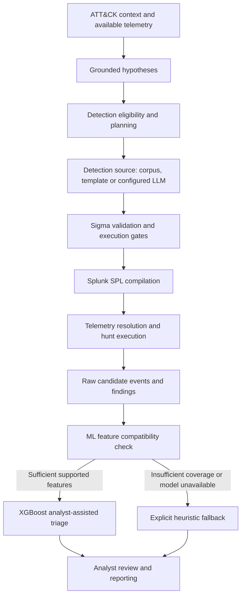

# AI-Powered Autonomous Threat Hunting Platform

**MSc cybersecurity research · Detection engineering · Analyst-assisted threat hunting**

An evidence-driven research and software platform for converting MITRE ATT&CK-grounded hunting hypotheses into validated Sigma detections, executable SIEM searches, and analyst-reviewable findings. It brings together a reproducible research pipeline with a FastAPI backend and React dashboard.

> **Project status:** Integrated platform v1.0.0 — core implementation complete and validated through CI, local tests, and API/UI/ML integration. **Ready for controlled deployment and live-stream telemetry acceptance testing.** Operational detection effectiveness on continuously arriving SIEM data remains to be verified.

[Architecture](docs/PLATFORM_ARCHITECTURE.md) · [Developer setup](docs/DEVELOPER_SETUP.md) · [Evaluation & limitations](docs/VALIDATION_AND_LIMITATIONS.md) · [Security](docs/SECURITY_AND_PRIVACY.md) · [Model distribution](docs/MODEL_DISTRIBUTION.md)

## What the platform does

| Capability | Implementation scope |
| --- | --- |
| Threat-hunting intelligence | ATT&CK-grounded hypotheses, technique selection, detection eligibility and plans |
| Detection engineering | Sigma drafting, rule validation, executable-query gating and Splunk SPL compilation |
| Hunt execution | Telemetry-source resolution, campaign orchestration and evidence-aware result handling |
| Assisted triage | Optional frozen XGBoost three-class scoring when supported features are present; explicit heuristic fallback otherwise |
| Analyst workflow | FastAPI services, React interface, findings review and reporting |
| Research reproducibility | Versioned hypotheses, detection rules, SPL outputs, evaluation summaries and provenance records |

The Qwen3-8B detection-generation model was evaluated in the research workflow. Running its inference backend is **optional and separately configured**; the presence of the provider interface does not mean the model is bundled or running locally. Template and corpus-based alternatives are identified by their actual generation method.

## System architecture

Validation, telemetry availability and human-review requirements are not interchangeable. A syntactically valid rule does not establish that a threat was detected, and a model-generated score is not a confirmed analyst verdict.

## Research evidence at a glance

The following figures describe **separate evaluation stages**, not a single end-to-end detection accuracy score.

| Research stage | Recorded result | Interpretation |
| --- | --- | --- |
| ATT&CK-grounded hypothesis corpus | **697** hypotheses | Research hypothesis inventory |
| Sigma generation and validation | **540** rules passed pySigma validation | Structural/semantic validation evidence, not proof of a true-positive hunt |
| Splunk compilation | **540** rules compiled to SPL | Compiler output, not a claim of available telemetry for every query |
| Hunting runtime | **404** execution-ready hunts run | **22** nonzero raw-result hunts; **0** confirmed true findings after validation |
| Fine-tuned Qwen3-8B evaluation | **223/286 (77.97%)** on the locked evaluation set | Task-specific rule-generation assessment, not autonomous deployment reliability |
| XGBoost triage | **0.4523** macro-F1 on organization-disjoint frozen test | Generalization limitation; approved only for **analyst-assisted triage** |

Supporting evidence: [Sigma rules and validation](artifacts/sigma/README.md), [Splunk execution and review](artifacts/splunk/README.md), [LLM evaluation](evaluation/llm/fine-tuned-model/README.md), [Frozen ML evaluation](backend/app/data/ml_triage/ml_triage_production_v1/evaluation/frozen_test_final_v1.json) and [validation limitations](docs/VALIDATION_AND_LIMITATIONS.md).

**Important ML boundary:** The frozen triage model was developed with GUIDE-style alert fields. Normal Sigma/EVTX hunt findings may not meet its feature-compatibility gate; such cases must show a **heuristic** result, not a falsely attributed ML prediction. The model does not autonomously suppress, close or finalize alerts.

## Repository guide

| Location | Purpose |
| --- | --- |
| [`backend/`](backend/) | FastAPI application, authentication, detection services, ML adapter and API tests |
| [`frontend/`](frontend/) | React/Vite analyst dashboard and report presentation |
| [`src/`](src/) | Research pipeline and reusable threat-hunting/data-preparation components |
| [`artifacts/`](artifacts/) | Versioned hypotheses, Sigma rules, SPL queries, telemetry and runtime evidence |
| [`configs/`](configs/) and [`config/`](config/) | Dataset registry and pipeline configuration; separate legacy/phase-specific configuration responsibilities |
| [`datasets/`](datasets/) | Dataset references, metadata and training-corpus documentation; not bulk raw data |
| [`evaluation/`](evaluation/) | Locked experiment and evaluation records |
| [`research/`](research/) and [`reports/`](reports/) | Academic material and research reporting |
| [`docs/`](docs/) | Architecture, setup, evaluation boundaries, privacy and model distribution |
| [`.github/workflows/`](.github/workflows/) | CI workflows, including the frontend build check |

Additional `scripts/`, `tests/`, `integrations/`, `schemas/` and `infra/` directories support the existing research and application workflows. The root README is an entry point, not a duplicate of their documentation.

## Getting started

1. Clone the repository and follow [Developer Setup](docs/DEVELOPER_SETUP.md) to configure the backend, frontend and environment variables. Do not commit local `.env` files or runtime databases.
2. Supply permitted telemetry and configure the desired SIEM connection. The research artifacts alone do not provide a live SIEM environment.
3. Configure the optional LLM provider separately if LLM-backed rule drafting is required; otherwise the interface must disclose its actual template/retrieval provider.
4. For XGBoost inference, obtain the **complete verified frozen model bundle** as described in [Model Distribution](docs/MODEL_DISTRIBUTION.md). A standard Git clone intentionally omits the 142 MB model file.
5. Run the applicable tests. Model-dependent tests may be skipped when the full inference bundle is absent; a successful frontend CI build does not validate the entire detection-to-triage workflow.

**Deployment readiness:** This remains a research-oriented integration. In addition to backend and UI tests, deployment requires real connector verification, a compatible model bundle, appropriately scoped credentials, and a measured end-to-end validation in the target environment.

## Evaluation, reproducibility and responsible use

Research outputs and operational claims are deliberately separated. The frozen ML test set is not a tuning set; the XGBoost policy is locked and **human review remains mandatory**. The Sigma/SPL runtime artifacts should not be presented as confirmed malicious detections where the evidence does not support that interpretation.

- [Architecture and execution boundaries](docs/PLATFORM_ARCHITECTURE.md)
- [Validation outcomes and limitations](docs/VALIDATION_AND_LIMITATIONS.md)
- [Security and privacy](docs/SECURITY_AND_PRIVACY.md)
- [Research and evidence navigation](docs/README.md)

The repository excludes private infrastructure details, credentials, bulky raw datasets and heavyweight model checkpoints. Dataset-specific licenses and terms of use remain applicable. Public visibility by itself does not grant rights to third-party data or software.

## Academic project

MSc cybersecurity research, 2025–2026.

**Project team:** Mohamed Youssef · Mohanad Ghoraba · Maryam Abdalbary · Sohila Mahmoud.

This project combines an implemented threat-hunting platform with a research contribution in grounded detection generation, validation gates, and held-out evaluation. Its software workflows have passed local and CI integration checks; live-stream SIEM acceptance and operational performance evaluation remain the next validation stage.
